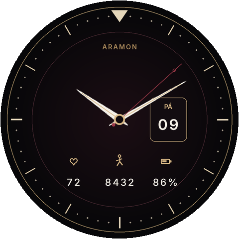

# Aramon

Analogový ciferník pro **Amazfit Balance** (první verze, kulatý displej 480×480).

Na ciferníku jsou ručičky, datum, český den v týdnu, tep, kroky a baterie. Při zhasnutém displeji zůstanou jen hodinky a minutová ručička na černém pozadí, ať AMOLED zbytečně nesvítí.



## Instalace do hodinek

1. Nainstalujte [Node.js](https://nodejs.org/) a Zeus CLI:

   ```bash
   npm i @zeppos/zeus-cli -g
   ```

2. V aplikaci Zepp otevřete **Profil → Nastavení → O aplikaci** a sedmkrát klepněte na ikonu Zepp. Tím se zapne vývojářský režim.

3. V adresáři tohoto projektu spusťte:

   ```bash
   zeus preview
   ```

4. V Zepp otevřete **Vývojářský režim**, vyberte ciferník a naskenujte QR kód z terminálu.

Hodinky musí být spárované s telefonem. Ciferník cílí na první Amazfit Balance (`deviceSource` 8519936, 8519937 a 8519939).

## Co je na ciferníku

- Čas ručičkami, vteřinová ručička je vínová.
- Datum a den v týdnu (`NE PO ÚT ST ČT PÁ SO`) v okénku vpravo.
- Dole tep, kroky a nabití baterie.
- Zhasnutý displej: hodinková a minutová ručička, indexy a černé pozadí.

Obrázky vznikají skriptem `python3 tools/generate_assets.py` (potřebuje Pillow a font Inter). Vygenerované soubory už v projektu jsou.

`appId` `28831009` stačí pro instalaci přes vývojářský režim. Do obchodu Zepp je potřeba vlastní ID z vývojářské konzole.
